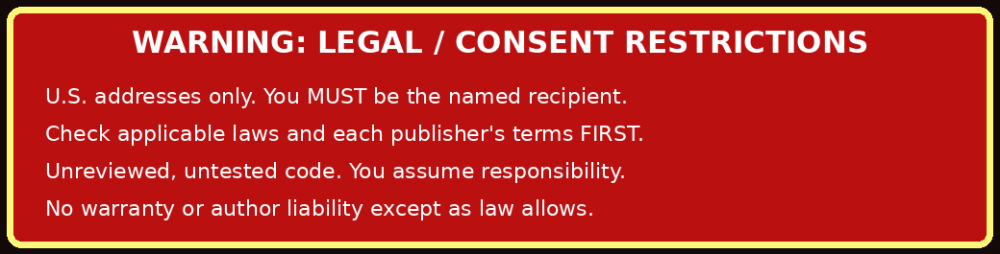

Spamalot keeps a local record of paper catalogs, newsletters, and magazines you request. It opens the publisher's page so you can decide what to send, and records the result you report. The bundled [Postal source directory](Postal-source-directory) includes each publisher's signup and removal instructions.



> [!WARNING]
> Use Spamalot only as the named recipient at your own lawful U.S. mailing address. Request mail only from publishers whose products, services, or publications you genuinely want. Check applicable laws, postal rules, and publisher terms first. Review the code before use. You accept responsibility and legal liability for your use. Spamalot is supplied as-is. The author disclaims warranty and liability to the extent permitted by law. Its legal ramifications and live publisher workflows have not been tested.

## Get started

Install from a clone or unpacked source directory with Python 3.10 or later.

```sh
python3 -m venv .venv
. .venv/bin/activate
python3 -m pip install .
```

Use a private working directory for your profile, database, and receipts. Start with a dry run to see which sources your filters select.

```sh
spamalot init
spamalot sources --category Catalog
spamalot subscribe --all --category Catalog --dry-run
```

When you want to request a publication, edit the generated `profile.json` with your own address and use `spamalot subscribe --source SLUG`. To stop mail from that source, use `spamalot unsubscribe --source SLUG` and follow the publisher's instructions. A receipt records the action you reported or the result the browser observed. Keep it for your records and confirm acceptance with the publisher if needed.

## Guides by topic

- [Getting started](Getting-Started) covers setup, consent, and upgrades.
- [Browser operations](Browser-Operations) covers requests, removal, and optional form adapters.
- [Source health](Source-Health) explains how to check and repair publisher links.
- [AI discovery](AI-Discovery) walks through provider setup and candidate review.
- [Receipts and data](Receipts-and-Data) explains local files and request outcomes.
- [Development](Development) covers tests, documentation generation, and wiki maintenance.
- [Troubleshooting](Troubleshooting) covers common publisher and CLI issues.
- [Safety and licensing](Safety-and-Licensing) covers the recipient and use restrictions.

## Reference

- [User guide](User-guide) covers installation, upgrades, and day-to-day use.
- [Command reference](Command-reference) covers selection, receipts, source checks, and optional discovery.
- [Source format](Source-format) covers CSV, JSON, and site-specific browser adapters.
- [Postal source directory](Postal-source-directory) lists the 45 bundled sources and their published opt-out routes.
- [Architecture and testing](Architecture-and-testing) explains storage, verification limits, and pull request checks.
- [Unix manual](Unix-manual) is the terminal reference, also available as `man spamalot`.
- [Changelog](Changelog) lists releases and changes.
- [License](License) contains the noncommercial share-alike terms and disclaimers.
- [Command examples](Commands), [source and format notes](Sources-and-Formats), and [module map](Architecture) are quick references.
- [Repository README](https://github.com/ckcameron/spamalot#readme) includes installation, upgrades, and examples.

[Edit the wiki sources in the repository](https://github.com/ckcameron/spamalot/tree/main/wiki).
