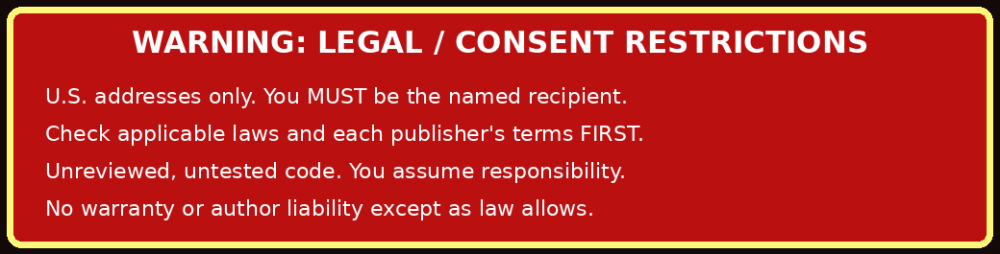

<p align="center"></p>

<div align="center">


</div>

> **`spamalot`** /ˈspæm.ə.lɒt/ — A consenting person's attempt to persuade their
> own mailbox to stop looking so lonely. **No borrowed identities, no third-party
> addresses, no CAPTCHA shenanigans.**

Spamalot keeps a local record of the **paper catalogs, newsletters, and magazines**
you ask publishers to send. It opens each publisher's page so you can review the
form and decide what to submit. It keeps a JSON receipt of the result you report.
The bundled registry lists **45 sources** with signup and removal instructions.

[Project wiki](https://github.com/ckcameron/spamalot/wiki) ·
[Command reference](Command-reference) · [Source directory](Postal-source-directory)

[Wiki maintenance](Development) explains how to update these pages.

<p align="center"></p>

**WARNING — read before running:** This project is untested for real-world legal
ramifications. **Use only your own legitimate U.S. mailing address, as the actual named
recipient.** You must genuinely want each publisher's goods, services, or publications;
check local/state/federal laws and each publisher's terms **before use**. The author
discourages using this project unreviewed or in its raw form. You must affirm your
consent and responsibility interactively. **You assume responsibility and legal liability
for your use.** The software is provided **as-is**, without warranty or author liability
**to the extent legally permissible**. No notice overrides non-waivable law.

**Accessibility:** The red warning above alternates at approximately 0.56 flashes per
second. The full legal text is also available here in static text and in the CLI.

The normal interactive workflow uses Python's standard library. Review publisher
pages, opt-out instructions, and AI suggestions before acting. Some print forms
also offer email, SMS, or fundraising contact. Decline channels you don't want.

---

## Installation

From a clone or unpacked source directory, install with Python 3.10 or later:

```sh
python3 -m venv .venv
. .venv/bin/activate
python3 -m pip install .
```

Run `spamalot init` from the working directory where you want to keep your data.
You can also run `python3 spamalot.py init` directly from the source directory
without installing anything.

A private `profile.json` template, `spamalot.sqlite3`, and `receipts/` are created.
Edit `profile.json` with your **own** accurate U.S. postal recipient/address.
Operational commands ask for the consent and liability acknowledgment in an
interactive terminal. Use `spamalot --help` to browse options.

For existing 1.0/1.1 users, retain your database and profile, replace the code and
bundled registry, then run:

```sh
spamalot sync-defaults
```

Existing installations using `postal_mail.sqlite3` can keep their history by
running commands with `--db postal_mail.sqlite3` (or by making a backup and
renaming the database to `spamalot.sqlite3` before restarting). Do not discard
your original database or private profile.

This merges newly bundled organizations without erasing previous events,
opt-outs, receipts or address information. Existing source details are left intact.
After inspecting registry changes, optionally run `sync-defaults --update` to
replace existing metadata. This does not re-enable manually disabled sources.

## Typical use

```sh
# List offerings or filter by publication type.
spamalot sources
spamalot sources --category Church
spamalot sources --category NGO
spamalot sources --category Political

# Preview the selection and save a local receipt.
spamalot subscribe --all --dry-run

# Explicit interactive postal requests, one at a time.
spamalot subscribe --source highcountrygardens
spamalot subscribe --file selected-sources.txt
spamalot subscribe --all --category Catalog

# Printed-mail cancellation remains a completely separate operation.
spamalot unsubscribe --source highcountrygardens
spamalot unsubscribe --file cancellation-sources.txt
spamalot unsubscribe --all
spamalot history
```

A selection file is a list of source slugs, one per line. A JSON list or CSV file
with a `slug` column also works. `unsubscribe --all` iterates over **every
historically requested subscription** in the local database, including sources
that have subsequently become disabled or broken. It is not a national
postal-mail suppression service. If a publisher only offers an email, letter,
customer-service phone number, or online preferences form to stop printed mail,
the application displays those instructions: it does not claim to have completed
that off-site process.

### Source maintenance

```sh
# Read-only HTTP checks of the published signup, postal opt-out, and evidence URLs.
spamalot check-sources --suggest
spamalot check-sources --source highcountrygardens
spamalot check-sources --source highcountrygardens --no-repair

# After personally checking a proposed new route on the same publisher domain:
spamalot adopt-url --source highcountrygardens --field subscribe_url --url https://www.highcountrygardens.com/pages/mail-sign-up

# Export enabled sources with healthy or unchecked status.
spamalot export-defaults --file reviewed-sources.json
spamalot import-sources --file additional-sources.csv
spamalot enable-source --source my-reviewed-source
spamalot disable-source --source unused-source
```

`check-sources` uses HTTPS GET only, limited redirects, public-IP validation,
basic HTML checks, and separate records for subscription and removal pages.
It may apply a canonical **same-organization HTTPS redirect** if the target
passes page heuristics. It never auto-adopts an unrelated domain. On an HTTP
404, 410, or a plausible soft-404 the source is marked `review`; after **two
consecutive such checks** it becomes `broken` and is excluded from future
`subscribe --all` operations. A transient timeout, rate limit, access challenge,
or other indeterminate response is flagged `review`, not deleted. Previous
subscription/opt-out history is never removed. Official homepage links are
presented as **suggestions only**. A domain migration may instead be handled
by manually updating a verified JSON/CSV record and importing it with `--update`.

**Limitations:** A live HTTP 200 is not evidence that a form is functional or
that the publisher sends print material. Some pages load forms dynamically.
The checker does not fill fields, submit a test subscription, bypass challenges,
or prove that an unsubscribe request has been processed.

### Optional research using public AI APIs

The `discover` command asks a search-grounded AI API for additional *potential*
print-only sources, including free paper catalogs, churches, nonprofits,
and policy magazines. A candidate must identify both an **official postal
signup** and a **published postal opt-out**. Returned records are stored in a
review queue, never silently inserted into the default source set.

Supply your own API key for one of these providers:

```sh
export OPENAI_API_KEY='your-api-key'
spamalot discover --provider openai --category 'free printed NGO newsletters'

export GEMINI_API_KEY='your-api-key'
spamalot discover --provider gemini --category 'free paper catalogs' --check

export PERPLEXITY_API_KEY='your-api-key'
spamalot discover --provider perplexity --category 'church postal magazines'

spamalot candidates
spamalot promote-candidate --id <candidate-uuid>
spamalot check-sources --source <slug>
spamalot enable-source --source <slug>
```

The AI request asks for current web citations, but its results may hallucinate
or link to email-only pages; verify every claim manually. The tool never sends
your `profile.json`, existing database, subscription history, or postal address
to the AI provider. The provider may charge for API and search usage, and its
API contract may change; check its current API documentation before using it.
The program requires an additional `SEARCH` confirmation before external AI calls.
No AI API keys are included in this project.

### Optional Playwright adapters

Normal assisted mode opens official pages and asks you to report what you
actually submitted. For a particular vetted site, you can supply exact CSS
field/submit/confirmation selectors via an `automation` object in a JSON source
file; then run `subscribe --source <slug> --automate`. With Playwright installed,
this opens a **visible browser**, fills only configured fields, and requires a
separate `SUBMIT` acknowledgment for each action. There are no verified default
adapters, and no automated CAPTCHA, payment, sweepstakes, or anti-bot workarounds.

## Files and audit model

| File | Description |
| --- | --- |
| `spamalot.py` | User CLI, source registry, SQLite schema/migration, consent and receipts |
| `source_health.py` | Read-only HTTP checker and link replacement suggestions |
| `source_discovery.py` | Optional OpenAI/Gemini/Perplexity API adapter; candidates only |
| `pyproject.toml` | Package metadata and the `spamalot` console entry point |
| `manuals.py` | Generates man page and reference Markdown |
| `spamalot_data/default-sources.json` | **Authoritative source registry**, 45 included records |
| `default-sources.csv` | Matching 45-record CSV for easy editing/review |
| `SOURCES.md` | Printed-mail request and cancellation directory |
| `docs/` and `man/man1/` | Generated manual sources (also regenerable via CLI) |
| `test_spamalot.py`, `test_maintenance.py` | Offline regression tests |
| `profile.json` | Created at first run; keep private; contains recipient PII |
| `spamalot.sqlite3` | Created locally; health, events, candidates, audit, URLs |
| `receipts/` | Timestamped local JSON receipts for acknowledged runs |

The program makes a receipt for each acknowledged CLI run, including dry-runs
and unsuccessful operations that reach the audit log. A receipt distinguishes
`user_reported_submitted`, `site_confirmation_observed`, `request_unverified`,
`not_submitted`, and `dry_run`; none is a guarantee of postal delivery.
The SQLite and receipts files should be secured and excluded from public VCS.

## Manual pages and development

```sh
spamalot build-docs --output .
man -l man/man1/spamalot.1
python3 -m unittest discover -v
python3 -m compileall -q spamalot.py source_health.py source_discovery.py manuals.py
```

The [GitHub Actions workflow](https://github.com/ckcameron/spamalot/blob/main/.github/workflows/tests.yml) runs the offline
suite and checks package installation on Python 3.10–3.14. Tests use temporary
databases and stubbed HTTP or provider responses. They do not verify live
publisher forms, cancellations, or paid AI requests.

The [architecture guide](Architecture-and-testing) explains how the registry,
receipts, source checks, and discovery fit together.

## Legal and recipient restrictions

This is U.S.-postal-address-only software, provided for consenting recipients
who have legitimate interest in every selected source's goods, services,
charitable programs, or printed material. You must be the named recipient at an
address where you lawfully receive mail. Inspect each organization's current
terms, eligibility and option to opt out of **physical mail** before proceeding.
Some publishers bundle optional email/SMS or fundraising contact with print
requests; decline additional channels where possible, and skip sources whose
requirements are unacceptable.

The program is **untested for real-world legal ramifications**. Review all
applicable municipal, state, and federal law, postal regulations, and individual
publisher terms. The author expressly discourages using the unmodified
software without personal review and modification. The operator accepts all
responsibility and legal liability for their conduct. The author disclaims
warranties and liability **only insofar as the law permits**; this disclaimer
cannot grant permission for unlawful conduct or waive non-waivable protections.

Potential uses include receiving free paper for personally produced compressed
paper bricks, **not** burning treated paper indiscriminately. EPA guidance warns
against burning magazines with colored inks, cardboard and trash in wood-burning
appliances: <https://www.epa.gov/burnwise/best-wood-burning-practices>.

**License:** CC BY-NC-SA 4.0, noncommercial sharing and adaptation with
attribution and share-alike. See `LICENSE.txt`. Creative Commons itself does
not generally recommend its licenses for software, so review license suitability
before redistribution.
